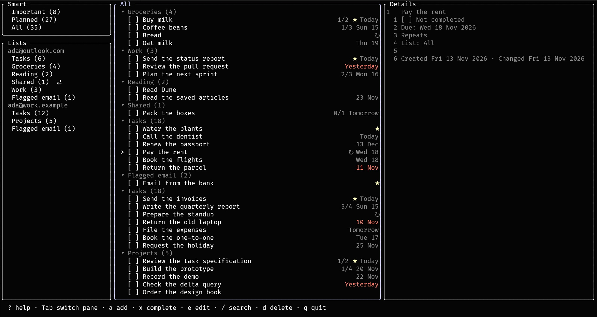
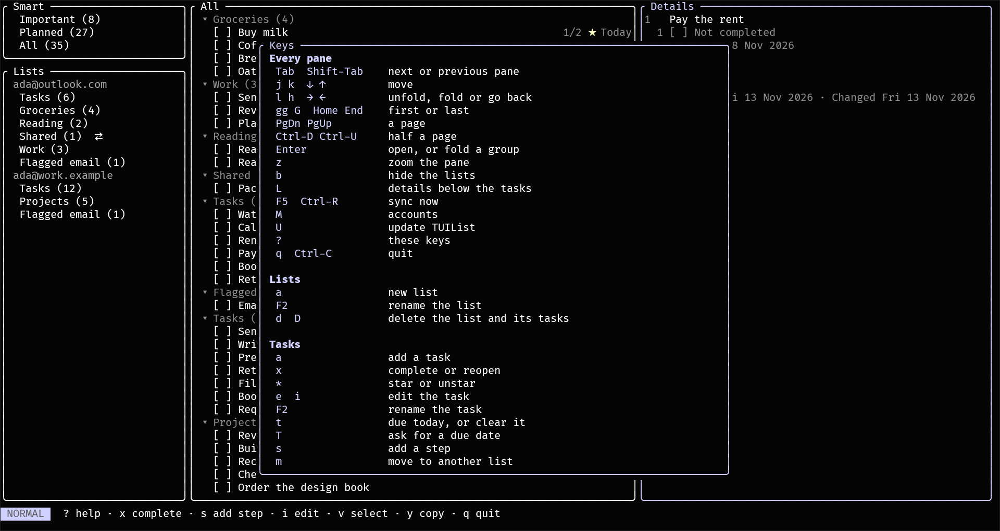
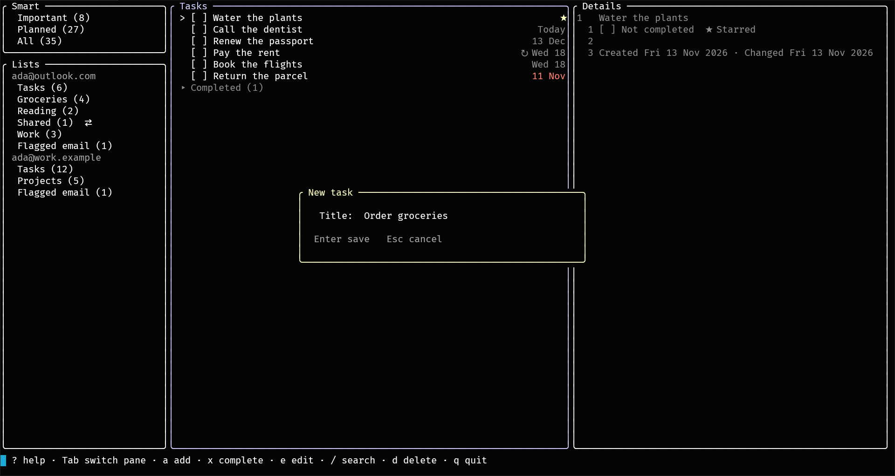

# TUIList

[](https://crates.io/crates/tuilist)
[](https://github.com/christianhelle/tuilist/actions/workflows/ci.yml)
[](LICENSE)

A terminal client for [Microsoft To Do](https://to-do.office.com/tasks/), with vim-style keys. Three panes show your
lists, tasks and details, an offline cache opens instantly, and sync runs in the
background.



## Install

tuilist installs as the `todo` command.

### macOS/Linux

```bash
curl -fsSL https://christianhelle.com/tuilist/install | bash
```

This installs the latest release to `~/.local/bin`. To install somewhere else,
or to pin a release:

```bash
curl -fsSL https://christianhelle.com/tuilist/install | INSTALL_DIR="$HOME/bin" bash
curl -fsSL https://christianhelle.com/tuilist/install | VERSION="0.1.1" bash
```

### Windows PowerShell

```powershell
irm https://christianhelle.com/tuilist/install.ps1 | iex
```

This installs the latest release to `%LOCALAPPDATA%\Programs\tuilist`, or to
`~\.local\bin` or `~\bin` if one of those already exists, and adds it to your
user `PATH`. To install somewhere else, or to pin a release:

```powershell
$install = irm https://christianhelle.com/tuilist/install.ps1
& ([scriptblock]::Create($install)) -InstallDir "$env:USERPROFILE\bin"
& ([scriptblock]::Create($install)) -Version "0.1.1"
```

### Cargo

With a recent stable [Rust](https://rustup.rs) toolchain (1.95 or later),
install it from [crates.io](https://crates.io/crates/tuilist):

```bash
cargo install tuilist --locked
```

### Release archives

Download a build from the
[releases page](https://github.com/christianhelle/tuilist/releases), unpack it
and put `todo` somewhere on your `PATH`. Archives are available for Linux,
macOS and Windows, on x64 and ARM64.

To try changes that aren't released yet, install straight from GitHub:

```bash
cargo install --git https://github.com/christianhelle/tuilist
```

## Sign in

```bash
todo login
```

A device code is printed; open the Microsoft page it names and enter the code.
Sign in again with `todo login` to add another account. Everything is cached per
account, so the next start opens instantly and syncs in the background.

```bash
todo accounts    # who is signed in
todo logout      # forget one account and its cache
todo sync        # fetch everything once, without the UI
```

Personal accounts use the `consumers` tenant, which is the default. Work or
school accounts use `organizations`, `common`, or a tenant ID:

```bash
todo --tenant organizations login
```

Use your own Entra ID public client with `--client-id` or
`TUILIST_CLIENT_ID`; it needs the delegated `Tasks.ReadWrite` permission.

## The screen

Move between panes with `Tab`, move with `j`/`k`, and press `?` for every key.
Favorites marked with `*` sit above the smart views, followed by each account's
lists.

## Keys

Press `?` from any pane for this list, wherever you are.



### Every pane

| Key | What |
| --- | --- |
| `Tab` / `Shift-Tab` | next or previous pane |
| `j` `k` / `↓` `↑` | move |
| `l` `h` / `→` `←` | unfold, fold or go back |
| `gg` `G` / `Home` `End` | first or last |
| `PgDn` `PgUp` | a page |
| `Ctrl-D` `Ctrl-U` | half a page |
| `Enter` | open, or fold a group |
| `z` | zoom the pane |
| `b` | hide the lists |
| `L` | details below the tasks |
| `F5` `Ctrl-R` | sync now |
| `M` | accounts |
| `U` | update TUIList |
| `?` | these keys |
| `q` `Ctrl-C` | quit |

### Lists

| Key | What |
| --- | --- |
| `a` | new list |
| `F2` | rename the list |
| `d` `D` | delete the list and its tasks |
| `*` | add or remove the list from the favorites |

### Tasks

| Key | What |
| --- | --- |
| `a` | add a task |
| `x` | complete or reopen |
| `*` | star or unstar |
| `e` `i` | edit the task |
| `F2` | rename the task |
| `t` | due today, or clear it |
| `T` | ask for a due date |
| `s` | add a step |
| `m` | move to another list |
| `d` `D` | delete |
| `y` | copy the title |
| `o` `gx` | open the first link in the browser |
| `c` | hide or show completed |
| `Space` | mark and move down |
| `Ctrl-A` | mark every task shown |
| `Esc` | clear the marks |

`a` asks for a title in the list shown, and `e` opens the full task form with
its due date, reminder, star and notes.



### Details

| Key | What |
| --- | --- |
| `h` `j` `k` `l` `w` `b` `e` | move the cursor |
| `v` `V` `y` | pick and copy |
| `x` | check the step, or complete the task |
| `s` | add a step |
| `i` | edit the task |
| `o` `gx` | open the link under the cursor |
| `→` `←` | next or previous task |

### Search

| Key | What |
| --- | --- |
| `/` | search every account |
| `Enter` | move into the results |
| `Esc` | return to the list |

## Try it without signing in

```bash
todo --demo
```

The demo has two accounts and sample lists, so you can look around before
connecting a real Microsoft account. Writes go through the same engine as a real
account, backed by temporary SQLite files.

## Sync

Sync runs at start, every 60 seconds, on `F5`, and with `todo sync`. The cache is
read immediately while the sync runs. Offline, cached lists and tasks keep
working; a write that cannot be sent is reverted and the reason is shown.

```bash
todo --sync-every 0     # only at start and on F5
```

Delta links are stored per list, so a sync usually fetches only what changed. An
expired delta link is dropped and that list is fetched whole once.

## Updates

TUIList checks GitHub once a day at start and shows a badge when a newer release
exists. `U` confirms before replacing the running binary; it runs from the next
start. The same is available without the UI:

```bash
todo check-update
todo update
```

Turn the start-up check off with `--no-update-check` or
`TUILIST_NO_UPDATE_CHECK=1`. A Cargo-installed TUIList is left for Cargo to
update.

## Options

| Option | Environment | Default | What |
| --- | --- | --- | --- |
| `--client-id` | `TUILIST_CLIENT_ID` | TUIList's app | Entra ID public client to sign in with |
| `--tenant` | `TUILIST_TENANT` | `consumers` | `consumers`, `organizations`, `common`, or a tenant ID |
| `--demo` | | off | browse sample lists without signing in |
| `--sync-every` | `TUILIST_SYNC_EVERY` | `60` | seconds between syncs; `0` only at start and on `F5` |
| `--no-update-check` | `TUILIST_NO_UPDATE_CHECK` | off | don't ask GitHub for a newer TUIList at start |

## Where things are kept

- Accounts, in sign-in order: the data directory's `accounts.json`.
- Each account's SQLite cache: a folder named after its address.
- The last screen (pane, list, task) and the favorites: `session.json` in the
  cache directory.
- Refresh tokens: the system keychain, under the account's address.

## Development

```bash
cargo fmt --all --check
cargo clippy --all-targets -- -D warnings
cargo test
```

The tests use `wiremock` for Graph, `insta` snapshots of a `TestBackend` render,
and an in-memory SQLite store. No test signs in or touches the keychain.

## License

MIT
